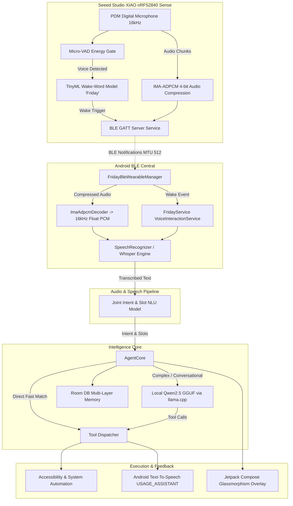

# Project Friday: Architecture Specification

## 1. System Overview & Philosophy
Project Friday is an end-to-end, privacy-first, 100% offline-capable agentic personal AI assistant ecosystem. It combines an ultra-low-power wearable hardware pendant (**Seeed Studio XIAO nRF52840 Sense**) with a high-performance on-device reasoning engine on Android (targetSdk 36, optimized for Samsung Galaxy S24).

The system operates without mandatory external cloud APIs, utilizing hardware acceleration (ARM NEON, DotProd), quantized local neural networks (ONNX Runtime, llama.cpp, whisper.cpp), and BLE 5.0 mesh communication.

---

## 2. Global System Topology

---

## 3. Wearable Hardware Pendant Architecture (Seeed XIAO nRF52840 Sense)

### 3.1 Hardware Specifications
- **MCU**: Nordic Semiconductor nRF52840 (32-bit ARM Cortex-M4F with FPU @ 64MHz, 1MB Flash, 256KB RAM).
- **Microphone**: MSM261D3526H1CPM Digital PDM Microphone (on-board).
- **Wireless**: Bluetooth 5.0 Low Energy (2.4 GHz transceiver).
- **Power Subsystem**: Ultra-low-power sleep states (~4-8 µA deep sleep), integrated BQ25100 LiPo battery charger (3.7V battery pads on back).
- **Feedback**: Onboard RGB User LED (Active LOW: `LED_RED`, `LED_GREEN`, `LED_BLUE`).

### 3.2 Pendant Firmware Architecture & Stages
1. **Audio Acquisition (`PDM.h`)**:
   - Captures raw 16kHz 16-bit PCM mono audio stream directly from PDM hardware peripheral using DMA.
2. **Stage 0: Micro-VAD Energy Gating**:
   - Calculates real-time Root-Mean-Square (RMS) amplitude and zero-crossing rate over 32ms frames.
   - Calibrated speech threshold floor (`MIN_SPEECH_RMS = 60.0f`, `VAD_MULTIPLIER = 1.40f`) filters room noise and babble before activating CNN inference.
3. **Stage 1: TinyML Wake-Word Engine ("Friday" via `wakeword_model.h`)**:
   - Runs a 1,697-parameter Depthwise Separable CNN on a 1.5-second (24,000 samples @ 16kHz) rolling circular buffer.
   - Extracts 16-band Log-Mel Spectrogram features (512 FFT with Hanning window, 384 hop, 62 frames) with zero dynamic memory allocation.
   - Trained on 723 hard negative samples (phonetic confusables like "freeday", "friend", "fire", "frida", "freddy", common command words, and ambient noise).
   - Multi-tier temporal verification: Requires either a single high-confidence detection (`score >= 0.86`) or two consecutive frames (`score >= 0.72` within 160ms) to trigger, eliminating single-frame transient false alarms.
   - Enforces a 3.5s cooldown after wake-word detection or audio streaming to prevent recursive self-triggering loops.
4. **Stage 2: BLE GATT Server (`bluefruit.h` via `Bluefruit52Lib`)**:
   - Built on the Nordic SoftDevice S140 stack bundled directly with Seeed nRF52 Boards.
   - **State Characteristic UUID**: `1F81DA01-B5A3-F393-E0A9-E50E24DCCA9E` (Notify / Read)
     - `0x01`: Wake-Word Trigger detected.
     - `0x02`: Pendant is currently recording speech.
     - `0x00`: Pendant in Idle / Listening state.
   - **Command Characteristic UUID**: `1F81DA02-B5A3-F393-E0A9-E50E24DCCA9E` (Notify / Write)
     - `0x00`: Direct plain text command (if on-device STT is available).
     - `0x01`: Audio Header (`totalChunks`, `totalBytes`, `sampleRate`) with 5x retry.
     - `0x02`: Audio Chunk (`chunkIndex` + IMA-ADPCM compressed payload) with flow control (preserves un-notified packets on TX buffer backpressure).
     - `0x03`: Audio End transmission sentinel with 5x retry.
     - `0x0A` / `0x0B` (Write): Mode toggle (`0x0A`: VAD streaming debug mode; `0x0B`: wake-word only).
     - Text write: Phone echoes recognized speech back to chip for USB Serial output.
5. **Stage 3: Fast Audio Compression (IMA-ADPCM)**:
   - Compresses 16-bit linear PCM down to 4 bits per sample (4:1 compression ratio).
   - 1 second of 16kHz audio = 8,000 bytes. Zero-loss transmission ensures pristine audio fidelity for phone speech-to-text.
   - 200ms pre-roll circular buffer preserves initial consonants before VAD trigger.

---

## 4. Android Software Architecture

The Android application is organized under package namespace `com.friday.assistant`:

### 4.1 Bluetooth Subsystem (`ble/`)
- **`FridayBleWearableManager.kt`**:
  - Central BLE manager operating in the background.
  - Automatic low-latency scanning (`ScanFilter` matching `Friday-Pendant`, `Friday-Wearable`, and `SERVICE_UUID`).
  - Negotiates MTU 512 for high-throughput packet transfers.
  - Automatically re-subscribes to GATT notifications on connection and manages exponential-backoff reconnections.
  - Dispatches `onWakeWordDetected`, `onCommandAudioReceived`, and `onCommandTextReceived` to `FridayService`.
- **`ImaAdpcmDecoder.kt`**:
  - High-performance, zero-allocation Kotlin audio decoder converting 4-bit ADPCM packets back to standard 16kHz float PCM `[-1.0f, 1.0f]`.

### 4.2 Core Service & UI Layer (`ui/` & `core/`)
- **`FridayService.kt`**:
  - System-bound `VoiceInteractionService` & `AccessibilityService` running continuously.
  - Manages assistant lifecycle: `IDLE` -> `LISTENING` -> `THINKING` -> `SPEAKING`.
  - Coordinates microphone ownership, audio focus (`AUDIOFOCUS_GAIN_TRANSIENT_MAY_DUCK` during listening, `EXCLUSIVE` during TTS).
  - Wearable activation routing: Does not activate phone microphone on wearable trigger; instead holds for BLE audio stream from the chip.
  - Anti-recursion cooldown: Enforces 3.0s cooldown and state validation to reject echo self-triggers.
  - Transcript Sanitizer (`cleanAndValidateTranscript`): Strips Whisper hallucination tokens (`[BLANK_AUDIO]`, `(music)`, `Thank you.`), rejects replacement characters (`\uFFFD`, `�`, `%08`), and requires >= 70% alphanumeric content before routing queries to NLU or web search.
- **`OverlayManager.kt` & Compose Overlays**:
  - WindowManager `TYPE_ACCESSIBILITY_OVERLAY` rendering glowing glassmorphic bubble, interactive typewriter text, source chips, and real-time audio waveforms.
  - Non-intrusive: top-anchored, passes through background touch events unless text input is requested.
- **`MainActivity.kt`**:
  - Dashboard featuring live diagnostics for Wearable BLE connectivity, model health checks, and quick toggle controls.

### 4.3 Audio & Speech Recognition Pipeline (`audio/`)
- **`SpeechToTextHelper.kt`**:
  - Reusable, low-latency Android `SpeechRecognizer` wrapper providing real-time partial word updates and RMS amplitude callbacks for phone-side interactions (volume key gestures, digital assistant power button).
- **`WhisperEngine.kt`**:
  - JNI bridge to `whisper.cpp` capable of offline transcription of raw audio buffers received from the BLE pendant.
  - Configured with hallucination suppression parameters (`suppress_blank = true`, `suppress_nst = true`, `no_context = true`, `single_segment = true`, `temperature = 0.0f`).
  - Gated by audio RMS energy check (`rms >= 0.008f`, `maxPeak >= 0.035f`) to eliminate transcription of silence/noise.
- **`SpeakerVerifier.kt`**:
  - ONNX ECAPA-TDNN embedding extractor to authenticate the user's voiceprint.

### 4.4 Intelligence & Neural Processing (`intelligence/`)
- **Dual-Stage NLU**:
  1. **Joint Intent & BIO Neural Slot-Filling Classifier (`NluIntentClassifier.kt`)**:
     - Single-pass transformer encoder (`joint_nlu_model.onnx`, 21.9 MB INT8 ONNX).
     - 46 Intent classes + 23 BIO slot tags with sub-6ms CPU latency.
  2. **Semantic Intent Router (`SemanticIntentRouter.kt`)**:
     - Cosine similarity matching against `all-MiniLM-L6-v2.onnx` sentence embeddings for zero-shot query generalization.
- **`AgentCore.kt`**:
  - Modular intent routing split across dedicated domain handlers:
    - Messaging & Calls (WhatsApp autonomous sending, Phone dials).
    - System Controls (Volume, Brightness, Flashlight/Torch, WiFi, Bluetooth).
    - Media Controls (Spotify auto-play, YouTube streaming).
    - Notes & Preferences (Room DB note creation/search/update, personal facts).
    - Alarms & Timers (Exact alarms, countdown timers).
    - Search & Navigation (Google Maps turn-by-turn, multi-tier web search).
  - Conversational fallback to local LLM when intent is ambiguous.
- **`LlamaEngine.kt`**:
  - Native JNI interface to `llama.cpp`, running quantized `Qwen2.5-0.5B-Instruct` or `1.5B-Instruct` GGUF models on CPU performance cores with flash attention and prompt caching.

### 4.5 Automation & Device Tools (`automation/` & `tools/`)
- **`FridayAccessibilityService`**:
  - Injected accessibility nodes with `dispatchGesture` for hardware-level coordinate taps (`dispatchTap(x, y)`), scrolling, and screen reading.
- **Tools**: Fully decoupled tool implementations executing system intents, content provider queries, and UI interactions.

---

## 5. End-to-End Data Flow

### Scenario A: Wearable Wake-Word + Wearable Audio Stream
1. User says "Friday, turn on the flashlight" into the Seeed XIAO pendant.
2. Pendant PDM mic captures audio; TinyML wake-word model triggers.
3. Pendant writes `0x01` to `STATE_CHAR_UUID` (phone receives BLE notification within 15ms).
4. Phone displays overlay and transitions to `LISTENING`.
5. Pendant compresses voice command using IMA-ADPCM and streams chunks via `COMMAND_CHAR_UUID`.
6. `FridayBleWearableManager` reassembles packets and decodes into 16kHz float PCM.
7. Phone transcribes audio via `whisper.cpp` (or local engine).
8. `AgentCore` evaluates transcript via Joint NLU -> identifies `toggle_torch` intent -> turns on flashlight via `CameraManager`.
9. Phone TTS speaks: "Flashlight turned on."

### Scenario B: Wearable Wake-Word + Phone High-Fidelity Mic Capture
1. User says "Friday" while wearing the pendant.
2. Pendant detects "Friday" and writes `0x01` to `STATE_CHAR_UUID`.
3. Phone immediately wakes screen, shows glowing overlay, and activates `SpeechToTextHelper.startListening()`.
4. User speaks command naturally towards their phone; phone's beamforming mic array captures command in real-time.
5. Command is parsed and executed instantly with zero audio packet transfer delay.

### Scenario C: Wearable VAD Voice Streaming + Local Phone STT (Debug Mode)
1. User speaks into the Seeed XIAO pendant microphone (no wake-word required).
2. Pendant detects energy above dynamic speech threshold (`currentRms >= speechThreshold` for 2+ consecutive frames).
3. Pendant writes `0x02` (`STATE_RECORDING_VOICE`) to `STATE_CHAR_UUID` and immediately sends Audio Header (`0x01`) with 200ms pre-roll.
4. Pendant compresses 16kHz audio using 4-bit IMA-ADPCM (128 bytes/frame) and streams packets (`0x02`) over BLE with flow control.
5. Phone receives chunks in real time, displays streaming indicator and visual audio waveforms on the overlay and in `MainActivity`.
6. When user stops speaking (silence > 450ms), pendant sends `0x03` (Audio End) and returns to idle.
7. Phone reassembles audio, decodes via `ImaAdpcmDecoder`, and runs local speech-to-text via `whisper.cpp`.
8. Phone immediately displays the transcribed text on the floating overlay and dashboard, and echoes the text back to the chip over BLE for Serial Monitor logging.

