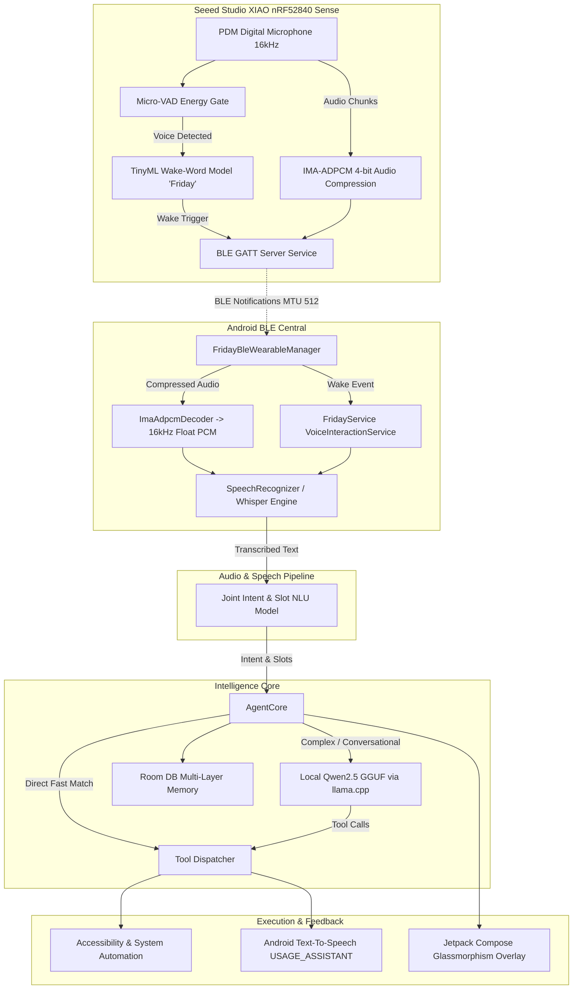

# Project Friday: Architecture Specification

## 1. System Overview & Philosophy
Project Friday is an end-to-end, privacy-first, 100% offline-capable agentic personal AI assistant ecosystem. It combines an ultra-low-power wearable hardware pendant (**Seeed Studio XIAO nRF52840 Sense**) with a high-performance on-device reasoning engine on Android (targetSdk 36, optimized for Samsung Galaxy S24).

The system operates without mandatory external cloud APIs, utilizing hardware acceleration (ARM NEON, DotProd), quantized local neural networks (ONNX Runtime, llama.cpp, whisper.cpp), and BLE 5.0 mesh communication.

---

## 2. Global System Topology

---

## 3. Wearable Hardware Pendant Architecture (Seeed XIAO nRF52840 Sense)

### 3.1 Hardware Specifications
- **MCU**: Nordic Semiconductor nRF52840 (32-bit ARM Cortex-M4F with FPU @ 64MHz, 1MB Flash, 256KB RAM).
- **Microphone**: MSM261D3526H1CPM Digital PDM Microphone (on-board).
- **Wireless**: Bluetooth 5.0 Low Energy (2.4 GHz transceiver).
- **Power Subsystem**: Ultra-low-power sleep states (~4-8 µA deep sleep), integrated BQ25100 LiPo battery charger (3.7V battery pads on back).
- **Feedback**: Onboard RGB User LED (Active LOW: `LED_RED`, `LED_GREEN`, `LED_BLUE`).

### 3.2 Pendant Firmware Architecture & Stages
1. **Audio Acquisition (`PDM.h`)**:
   - Captures raw 16kHz 16-bit PCM mono audio stream directly from PDM hardware peripheral using DMA.
2. **Stage 0: DC-Removed Micro-VAD Energy Gating & Boot Calibration**:
   - Dynamic AC Noise Floor Calibration: `onPDMdata()` subtracts per-frame DC offset before computing Root-Mean-Square (RMS), eliminating static mic/ADC biases (-548 to +211 ADC counts).
   - Adaptive speech threshold (`speechThreshold = backgroundRms * 1.35f + 15.0f`, minimum floor `MIN_SPEECH_RMS = 110.0f`, background ceiling `MAX_BG_RMS = 300.0f`) ensures soft speech triggers cleanly in silence while preventing loud room music from starving normal-volume speech.
3. **Stage 1: TinyML Wake-Word Engine ("Friday" via `wakeword_model.h`)**:
   - Runs a 25,489-parameter Translation-Invariant Depthwise Separable CNN + 1D Temporal Motif Conv (`PhoneticWakeWordNetV2`) on a 1.5-second (24,000 samples @ 16kHz) rolling circular buffer (~143 KB total sketch Flash, ~141 KB total static BSS RAM).
   - **Per-Window DC Removal & 4-Layer Phonetic Defense Architecture**:
     - **DC Subtraction (`meanRaw`) & AC Peak Gate (`acMaxAbs < 300.0f`)**: Strips window DC mean prior to AC peak normalization and FFT, ensuring uniform behavior across sessions and preventing DC offsets or low ambient rustle from bypassing the silence gate.
     - **32 Mel Filterbank Channels & 4 DS-Conv Blocks (`1->16->32->48->48`)**: Resolves formant trajectories F1 (300-800 Hz) and F2 (800-2200 Hz) into 8 chronological time slices.
     - **1D Temporal Motif Conv (`Conv1d(48, 64, kernel_size=5)`) + Global Max/Avg Dual-Pooling (`128 -> 32 -> 1`)**: Detects the ordered phoneme progression /f/ -> /r/ -> /aI/ -> /d/ -> /eI/ anywhere inside the 1.5s sliding window (`97.4% - 100.0%` recall across ±400ms shifts), achieving `0` triggers on unseen loud music (562 windows), unseen TV/cough (306 windows), unseen JFK speech (119 windows), and unseen TTS voices (109 clips).
     - **Layer 3 (Spectral Variance Pre-Filter)**: Instantly rejects stationary room noise and hiss (`variance < 0.052f`).
   - **Multi-Frame Temporal Verification** (no single-frame instant triggers): Fires only on 2 consecutive 80ms frames `>= 0.90` (`avg >= 0.92`, ~160ms) OR 3 consecutive frames `>= 0.82` (`latest >= 0.85`, ~240ms), eliminating isolated spikes and noisy mild-room triggers.
   - Enforces a 4.0s cooldown after wake-word detection or audio streaming to prevent recursive self-triggering loops.
4. **Stage 2: BLE GATT Server (`bluefruit.h` via `Bluefruit52Lib`)**:
   - Built on the Nordic SoftDevice S140 stack bundled directly with Seeed nRF52 Boards, configured with `Bluefruit.configPrphBandwidth(BANDWIDTH_MAX)` to support MTU 247.
   - **State Characteristic UUID**: `1F81DA01-B5A3-F393-E0A9-E50E24DCCA9E` (Notify / Read)
     - `0x01`: Wake-Word Trigger detected.
     - `0x02`: Pendant is currently recording command speech (`~416ms` end hangover).
     - `0x03`: Pendant is in Continuous Listen / Dictation Mode (uninterrupted ADPCM streaming until stopped via phone `0x12` or UI).
     - `0x00`: Pendant in Idle / Listening state.
   - **Command Characteristic UUID**: `1F81DA02-B5A3-F393-E0A9-E50E24DCCA9E` (Notify / Write)
     - `0x00`: Direct plain text command (if on-device STT is available).
     - `0x01`: Audio Header (`totalChunks`, `totalBytes`, `sampleRate = 16000`) with 5x retry.
     - `0x02`: Audio Chunk (`chunkIndex` + IMA-ADPCM compressed payload). Dynamically adapts chunk size based on negotiated MTU: full 128-byte ADPCM payload (256 samples) when MTU >= 134; 16-byte ADPCM payload (32 samples = 19B packet) when MTU < 134, completely eliminating packet truncation.
     - `0x03`: Audio End transmission sentinel with 20x retry.
     - `0x04`: Stabilized Battery Telemetry (`percent`, `millivolts` BE) sampled via `VBAT_ENABLE` (`P0.14`) with 10ms RC settling, 16-sample trimmed median, 80/20 EMA (`filteredBatteryMv`), 11-point piecewise LiPo LUT (3300-4200 mV), and +-1% rate clamp reported on connect and every 30s in IDLE.
     - `0x10` write (Phone -> Pendant): Signals TTS playback started on phone, arming immediate voice barge-in cooldown (`650ms`).
     - `0x11` / `0x12` write (Phone -> Pendant): Starts (`0x11`) / stops (`0x12`) `STATE_CONTINUOUS_LISTEN` dictation streaming.
     - Text write: Phone echoes recognized speech back to chip for USB Serial output.
5. **Stage 3: Fast Audio Compression (IMA-ADPCM)**:
   - Compresses 16-bit linear PCM down to 4 bits per sample (4:1 compression ratio).
   - 1 second of 16kHz audio = 8,000 bytes. Zero-loss transmission ensures pristine audio fidelity for phone speech-to-text.
   - 200ms pre-roll circular buffer preserves initial consonants before VAD trigger.

---

## 4. Android Software Architecture

The Android application is organized under package namespace `com.friday.assistant`:

### 4.1 Bluetooth Subsystem (`ble/`)
- **`FridayBleWearableManager.kt`**:
  - Central BLE manager operating in the background.
  - Automatic low-latency scanning (`ScanFilter` matching `Friday-Pendant`, `Friday-Wearable`, and `SERVICE_UUID`).
  - Negotiates MTU 512 and requests `CONNECTION_PRIORITY_HIGH` (coupled with pendant-side `BLE_GAP_PHY_2MBPS` and 7.5 ms connection interval).
  - Sequential GATT CCCD subscription queue: Ensures descriptor writes for `STATE_CHAR_UUID` and `COMMAND_CHAR_UUID` complete sequentially via `onDescriptorWrite()`, eliminating GATT collision drops.
  - Platform deduplication: Binds deprecated `onCharacteristicChanged` exclusively on Android < 13 to eliminate double-firing and stale buffer reads on Samsung One UI (Android 14/15).
  - Stateful streaming architecture: `StreamImaAdpcmDecoder` decodes 4-bit IMA-ADPCM chunks continuously on arrival with preserved predictor state and zero redundant end-of-stream re-decoding.
  - Watchdog & delivery resilience: Automatically finalizes and dispatches collected audio upon receiving `0x03` Audio End sentinel, `0x00` (IDLE) state update, or after a 1800ms silence watchdog timer to prevent premature truncation during BLE delays. Non-destructive `0x02` state updates preserve any audio chunks already buffered after the `0x01` header.
  - Dispatches `onWakeWordDetected`, `onAudioStreamStarted`, `onAudioChunkReceived`, `onCommandAudioReceived`, and `onCommandTextReceived` to `FridayService`.
- **`StreamImaAdpcmDecoder` & `ImaAdpcmDecoder`**:
  - Stateful, zero-allocation Kotlin audio decoder converting 4-bit ADPCM chunks back to standard 16kHz float PCM `[-1.0f, 1.0f]`.

### 4.2 Core Service & UI Layer (`ui/` & `core/`)
- **`FridayService.kt`**:
  - System-bound `VoiceInteractionService` & `AccessibilityService` running continuously.
  - Manages assistant lifecycle: `IDLE` -> `LISTENING` -> `THINKING` -> `SPEAKING`, with generation-guarded `interruptActivePipeline()` for instant speak-interrupt barge-in across both phone mic (`SPEAKING`-only `WakeWordDetector`) and BLE pendant (`0x10` cooldown reset).
  - Coordinates microphone ownership, audio focus (`AUDIOFOCUS_GAIN_TRANSIENT_MAY_DUCK` during listening and TTS confirmation).
  - Wearable activation routing: Does not activate phone microphone on wearable trigger; instead holds for BLE audio stream from the chip, pre-warming `WhisperEngine` on BLE connection.
  - Strict Wake-Word Gating: The overlay UI is strictly gated behind confirmed on-chip wake-word events (`isPendantWakeActive` set synchronously on wake trigger, extended dynamically while chunks stream); unauthenticated or rogue BLE audio streams are dropped immediately with zero UI interruption.
  - Live Streaming Speech-to-Text: Runs throttled, abortable (`ggml_abort_callback`) background partial Whisper transcription during authenticated BLE voice streaming (`chunkIdx >= 50`), displaying words on the overlay in real time without blocking final transcription and preserving `lastPartialTranscript` as fallback.
  - Command Audio Energy Gating & Normalization: Strips DC offset prior to AC energy checks (`acRms >= 0.0014f`, `acMaxPeak >= 0.009f`, never dropping if `lastPartialTranscript` already captured valid speech), trims silence (`0.008f` AC threshold), normalizes gain up to `12.0f` (`preprocessPendantAudio`), and runs `ContactHelper.correctTranscript` on BLE transcripts.
  - Transcript Sanitizer (`cleanAndValidateTranscript`): Strips Whisper hallucination tokens (`[BLANK_AUDIO]`, `(music)`, `Thank you.`), rejects replacement characters (`\uFFFD`, `�`, `%08`), and requires >= 70% alphanumeric content before routing queries to NLU or web search.
- **`InstalledAppsCache.kt`**:
  - In-memory 5-minute TTL cache of installed application labels and launch intents, shared between `PostClassificationValidator` and `AppLauncherTool` to eliminate synchronous PackageManager IPC scans.
- **`OverlayManager.kt` & Theme-Reactive HUD (`FridayOverlayContent.kt`, `AudioWaveformComposable.kt`)**:
  - WindowManager `TYPE_ACCESSIBILITY_OVERLAY` consuming `ThemeStore` / `LocalFridayColors`, rendering orbital brand indicators, pre-allocated `Path` waveforms driven by microphone RMS, and `LinkAnnotation.Url` typewriter responses.
  - Non-intrusive: top-anchored, passes through background touch events unless text input is requested.
- **`MainActivity.kt`, `FridayViewModel.kt` & Reactive Screens (`ui/screens/`, `ui/theme/ThemeStore.kt`)**:
  - Clean 3-tab shell (`Home`, `Assistant`, `Vault`) with pushed `Settings` and `ThemeStudio` destinations backed by `FridayViewModel` (`AndroidViewModel`), Room v3 Flows (`ReminderEntity`, `NoteEntity` with `isPinned`, `RoutineEntity`, `MemoryEntity`, `BriefItemEntity`), `CalendarTool` events, `NotificationService` state flow, and `SportsScoreTool` live cards.
  - **`ThemeStore`**: Persists curated palettes (`Obsidian Amber` default, `Crimson Graphite`, `Champagne Bronze`, `Monochrome Titanium`, `Warm Paper`) and custom HSL accent/surface styles into `StateFlow` so both the app UI and floating overlay update live.
- **Persistence & Proactive Scheduling (`core/db/`, `intelligence/brief/`, `ReminderScheduler.kt`, `ReminderReceiver.kt`)**:
  - Room Database v3 (`MIGRATION_2_3`) storing reminders (`ReminderEntity`) and pinned notes (`isPinned`); exact alarm scheduling guarded by `canScheduleExactAlarms()` and safe `goAsync()` + short-lived `TextToSpeech` fallback in `ReminderReceiver`.
  - `ProactiveDigestWorker` & lightweight RSS `BriefWorker` delivering morning/evening summaries cleanly without requiring charging locks for non-LLM RSS sync.

### 4.3 Audio & Speech Recognition Pipeline (`audio/`)
- **`SpeechToTextHelper.kt`**:
  - Reusable, low-latency Android `SpeechRecognizer` wrapper providing real-time partial word updates and RMS amplitude callbacks for phone-side interactions (volume key gestures, digital assistant power button).
  - Explicitly targets external system recognition services (Google `com.google.android.googlequicksearchbox` or Samsung `com.samsung.android.bixby.agent`) via `ComponentName`, bypassing Friday's internal `RecognitionService` assistant registration stub.
- **`WhisperEngine.kt`**:
  - JNI bridge to `whisper.cpp` capable of offline transcription of raw audio buffers received from the BLE pendant.
  - Configured with hallucination suppression parameters (`suppress_blank = true`, `suppress_nst = true`, `no_context = true`, `single_segment = true`, `temperature = 0.0f`).
  - Gated by audio RMS energy check (`rms >= 0.003f`, `maxPeak >= 0.015f`) to eliminate transcription of silence/noise.
- **`WakeWordDetector.kt` (Phone Barge-In & Optional Idle KWS)**:
  - Runs the same zero-false-alarm `PhoneticWakeWordNetV2` (`wakeword_model.h`) natively via `friday_jni.cpp` (`predictWakeWordNative`) with DC-removed AC VAD (`MIN_SPEECH_RMS = 110f`, `VAD_MULTIPLIER = 1.35f`) and multi-frame confirmation (`2` consecutive `>= 0.90` with `avg >= 0.92`, OR `3` consecutive `>= 0.82` with `latest >= 0.85`).
  - During `SPEAKING` of substantial responses (`>= 45` chars or streaming LLM), runs in barge-in mode alongside `AcousticEchoCanceler`.

### 4.4 Intelligence & Neural Processing (`intelligence/`)
- **Single-Pass 12-Layer Joint NLU v3 (`NluIntentClassifier.kt` + `PostClassificationValidator.kt`)**:
  - Single-pass 12-layer transformer (`BAAI/bge-small-en-v1.5`, `joint_nlu_model.onnx`, 66.59 MB INT8 linear-quantized ONNX) predicting **59 Intent classes** (adding `reminder_delete`, `dictation_start`, `dictation_stop`) + **23 BIO slot tags** (`decodeBioSlots` with orphan `I-X` span promotion).
  - `PostClassificationValidator.validateRules(...)` applies deterministic keyword rescues (`dictation_start`, `reminder_delete`, `notes_delete`, `set_reminder`, `reminder_list`, `calendar_add`/`calendar_list` incl. `"schedule"`, `play_youtube` for `on youtube`, `set_alarm`, `set_timer`, `take_screenshot`, `volume_up/down`, `torch_toggle`, `brightness_down`, system toggles) and enforces the **Strict Web Search Lock** (blocks `search_google`/`web_search` unless `\bsearch\b` was spoken).
- **`RoutineManager.kt`**:
  - Parses `"create routine <name> that ..."` / `"when i say <phrase> ..."` definitions into `RoutineEntity` multi-step command macros and dispatches steps cleanly through `AgentCore`.
- **`AgentCore.kt`**:
  - Executed off the main thread (`Dispatchers.Default`) from `FridayService` so `AutomationBridge` calls (`GLOBAL_ACTION_LOCK_SCREEN`, `GLOBAL_ACTION_TAKE_SCREENSHOT`) complete in `< 350ms` without blocking `mainHandler`.
  - Evaluates deterministic domain handlers *before* LLM or search fallback (even when NLU confidence `< 0.60f`), preventing device/reminder/schedule commands from leaking into fallback handlers:
    - Dictation Mode (`"Friday, listen"` / `"listen to this"` -> `shouldStartDictation` -> continuous `STATE_CONTINUOUS_LISTEN` ADPCM streaming -> full session audio accumulation -> 25s multi-window Whisper transcription with `isLongForm = true` (unlimited tokens) -> saves complete interview to `NoteEntity` on stop or UI tap).
    - Routines, Reminders & Schedule (multi-step `RoutineManager`, Room v3 `ReminderScheduler` incl. delete all/matching, Calendar `add_event`/`list_events` supporting `"schedule"` & `only_today`).
    - Messaging & Calls (WhatsApp autonomous sending, Phone dials, `NotificationService` triage; excludes plain `"open whatsapp"` from message collision).
    - System Controls (Volume incl. `"turn up/down the music"`, Torch-before-Brightness, instant Biometric screen lock & screenshot, WiFi, Bluetooth, DND, Airplane, Mobile Data).
    - Media Controls (instant `search_youtube` results for `"search ... on youtube"`, YouTube Music / YouTube playback, next/previous track, pause).
    - Notes & Preferences (Room DB note creation/pinning/search/update/delete by ID, `"all"`, `"last"`, or keyword; semantic memory keys via `PreferenceExtractor`).
    - Search, Sports & Navigation (Google Maps turn-by-turn, `SportsScoreTool` live cricket & football scores + team follow/unfollow, and web/Google search **strictly locked to queries containing `\bsearch\b`**).
  - Conversational fallback to local LLM when intent is unmatched, with clear non-searching prompt when LLM is unavailable and `'search'` was not spoken.
- **`LlamaEngine.kt` & `friday_jni.cpp`**:
  - Native JNI interface to `llama.cpp`, running quantized `Qwen2.5-0.5B-Instruct` GGUF models on CPU performance cores with `LLAMA_FLASH_ATTN_TYPE_ENABLED`, common-prefix KV reuse (`llama_memory_seq_rm`), and `ggml_abort_callback` interruption.

### 4.5 Automation & Device Tools (`automation/` & `tools/`)
- **`FridayAccessibilityService`**:
  - Injected accessibility nodes with `dispatchGesture` for hardware-level coordinate taps (`dispatchTap(x, y)`), scrolling, screen reading, and biometric-preserving screen locking (`GLOBAL_ACTION_LOCK_SCREEN`).
- **Tools**: Fully decoupled tool implementations executing system intents, content provider queries, live sports feeds (`SportsScoreTool`), and UI interactions.

---

## 5. End-to-End Data Flow

### Scenario A: Wearable Wake-Word + Wearable Audio Stream
1. User says "Friday, turn on the flashlight" into the Seeed XIAO pendant.
2. Pendant PDM mic captures audio; TinyML wake-word model triggers.
3. Pendant writes `0x01` to `STATE_CHAR_UUID` (phone receives BLE notification within 15ms).
4. Phone displays overlay and transitions to `LISTENING`.
5. Pendant compresses voice command using IMA-ADPCM and streams chunks via `COMMAND_CHAR_UUID`.
6. `FridayBleWearableManager` reassembles packets and decodes into 16kHz float PCM.
7. Phone transcribes audio via `whisper.cpp` (or local engine).
8. `AgentCore` evaluates transcript via Joint NLU -> identifies `toggle_torch` intent -> turns on flashlight via `CameraManager`.
9. Phone TTS speaks: "Flashlight turned on."

### Scenario B: Wearable Wake-Word + Phone High-Fidelity Mic Capture
1. User says "Friday" while wearing the pendant.
2. Pendant detects "Friday" and writes `0x01` to `STATE_CHAR_UUID`.
3. Phone immediately wakes screen, shows glowing overlay, and activates `SpeechToTextHelper.startListening()`.
4. User speaks command naturally towards their phone; phone's beamforming mic array captures command in real-time.
5. Command is parsed and executed instantly with zero audio packet transfer delay.

### Scenario C: Wearable VAD Voice Streaming + Local Phone STT (Debug Mode)
1. User speaks into the Seeed XIAO pendant microphone (no wake-word required).
2. Pendant detects energy above dynamic speech threshold (`currentRms >= speechThreshold` for 2+ consecutive frames).
3. Pendant writes `0x02` (`STATE_RECORDING_VOICE`) to `STATE_CHAR_UUID` and immediately sends Audio Header (`0x01`) with 200ms pre-roll.
4. Pendant compresses 16kHz audio using 4-bit IMA-ADPCM (128 bytes/frame) and streams packets (`0x02`) over BLE with flow control.
5. Phone receives chunks in real time, displays streaming indicator and visual audio waveforms on the overlay and in `MainActivity`.
6. When user stops speaking (silence > 450ms), pendant sends `0x03` (Audio End) and returns to idle.
7. Phone reassembles audio, decodes via `ImaAdpcmDecoder`, and runs local speech-to-text via `whisper.cpp`.
8. Phone immediately displays the transcribed text on the floating overlay and dashboard, and echoes the text back to the chip over BLE for Serial Monitor logging.

